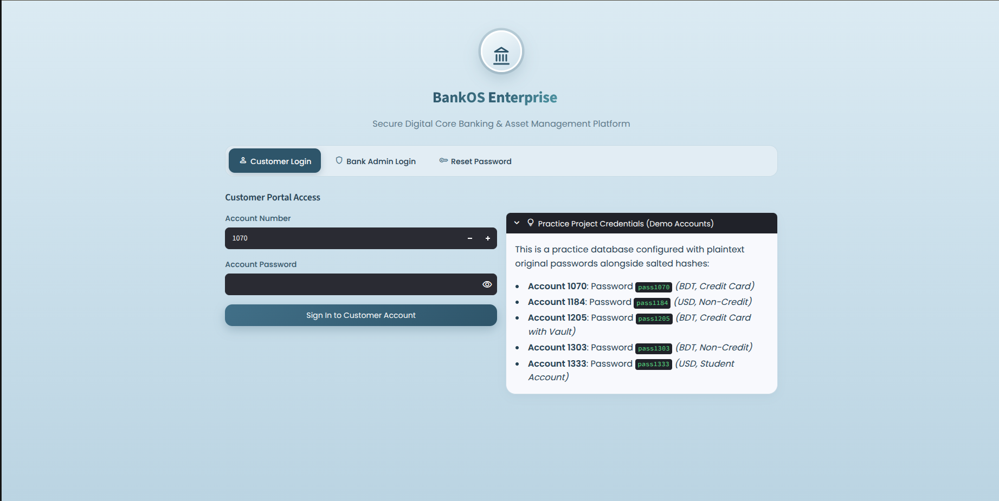
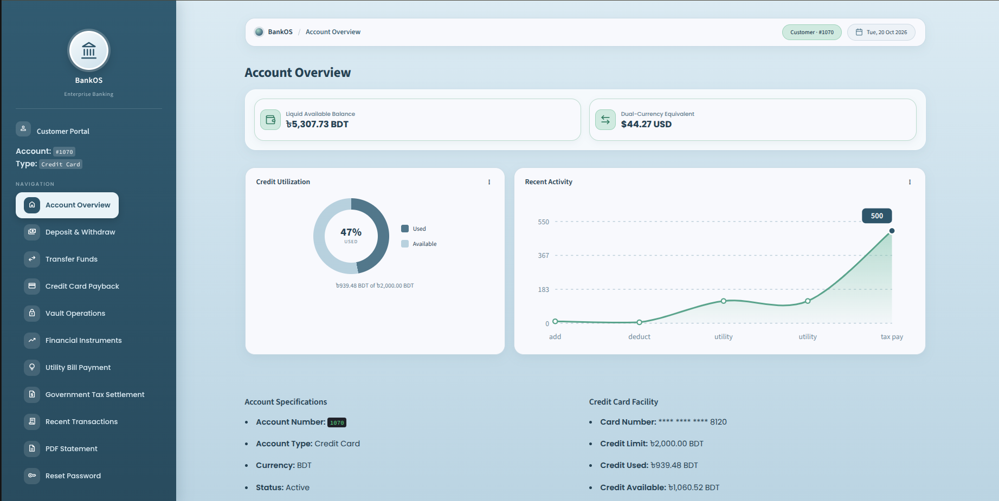
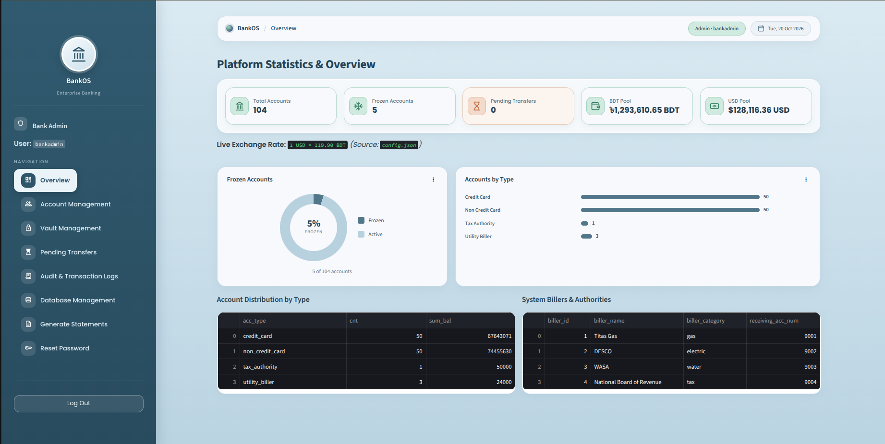

# BankOS v4 — Enterprise Financial System

A practice banking platform that keeps **all operational and audit data in one SQLite database** (`data/bank.db`) and exposes it through two front ends built on the same core modules:

- **Streamlit web app** — `app.py` (customer + admin portals)
- **Terminal CLI** — `main.py`

> [!WARNING]
> **Practice project, demo only.** Do not enter real personal, banking or financial data.

---

## Interface

| Login | Customer Portal | Admin Portal |
|:---:|:---:|:---:|
|  |  |  |
| Customer / Admin login and password reset | Balances, credit utilization, recent activity | Platform stats, frozen accounts, billers |

---

## Table of Contents

1. [Features](#features)
2. [Quick Start](#quick-start)
3. [Project Structure](#project-structure)
4. [Interfaces](#interfaces)
5. [Banking Rules](#banking-rules)
6. [Security](#security)
7. [Database Schema](#database-schema)
8. [Import & Export](#import--export)
9. [Configuration](#configuration)
10. [Changelog](#changelog)

---

## Features

- **Accounts** — create, convert, freeze/unfreeze, delete, set daily transfer limits
- **Money movement** — deposit, withdraw, transfers (cross-currency, threshold-checked), credit-card payback
- **Vaults** — secured cash storage plus physical asset records (gold, deeds, bonds, heirlooms)
- **Financial instruments** — loans, bonds, checks
- **Bills & taxes** — utility bill and government tax payments routed to seeded billers
- **Admin controls** — pending-transfer approval queue, audit/transaction logs, database tools
- **Reporting** — PDF account statements
- **Password reset** — security-question based, for both customers and admins
- **Student accounts** — parent contact info, fee waivers, mock SMS alerts
- **Dual currency** — BDT and USD with a live rate from `config.json`

---

## Quick Start

```bash
# 1. Install dependencies
pip install -r requirements.txt

# 2. Run the web app (from the project root, so Streamlit picks up .streamlit/config.toml)
streamlit run app.py
```
```bash
# or run the terminal version
python main.py
```

**Demo logins** (also shown on the login page):

| Role | Username / Account | Password |
|---|---|---|
| Bank Admin | `bankadmin` | `bankadmin` |
| Customer (BDT, Credit Card) | `1070` | `pass1070` |
| Customer (USD, Non-Credit) | `1184` | `pass1184` |
| Customer (BDT, Credit Card + Vault) | `1205` | `pass1205` |
| Customer (BDT, Non-Credit) | `1303` | `pass1303` |
| Customer (USD, Student) | `1333` | `pass1333` |

> Sample data can be seeded from the CLI: **Admin → Database Management → Seed sample data**.

---

## Project Structure

```
BankOS/
├── app.py                      # Streamlit web app (entry point: streamlit run app.py)
├── main.py                     # Terminal CLI (entry point: python main.py)
├── config.json                 # Active DB path + live usd_to_bdt_rate
├── requirements.txt            # Python dependencies
├── README.md
├── .gitignore
│
├── models/                     # Domain objects
│   ├── __init__.py
│   └── account_cls.py          # Account, credit card, student account, vault, payment objects
│
├── utils/                      # Everything the two front ends share
│   ├── __init__.py
│   ├── paths.py                # Central path config (project root, data/, statements/, config.json)
│   ├── storage.py              # Unified SQLite schema, auth, CRUD, transfers, logs,
│   │                           # pending approvals, import/export, billers, vault ops
│   ├── logic.py                # Loan / bond / check business logic
│   ├── currency.py             # BDT/USD conversion, minor-unit helpers, live rate lookup
│   ├── security.py             # Salted hashing + lockout timing helpers
│   ├── validinput.py           # CLI validators and prompt wrappers
│   └── reports.py              # PDF statement generator (fpdf2)
│
├── data/
│   ├── bank.db                 # Central SQLite database (the only DB in use)
│   └── *.db                    # Four empty legacy v2 log databases (unused, safe to delete)
│
├── statements/                 # Generated PDF statements
│
└── interface/            # README images (login, customer, admin)
```

**How the code fits together**

```
app.py / main.py  ──►  utils.storage  ──►  utils.logic, utils.currency, utils.security, utils.paths
        │                    │
        │                    └──►  models.account_cls  ──►  utils.security, utils.currency
        └──►  utils.reports, utils.validinput (CLI), utils.currency
```

The diagram is simplified: `utils.logic` imports `utils.storage` lazily inside its functions to avoid a circular import.

Imports use the package paths, for example `from utils.storage import init_storage` and `from models.account_cls import Account`. Run `streamlit run app.py` or `python main.py` from the project root.

All file paths are defined once in `utils/paths.py` and anchored to the project root, so the app finds `config.json`, `data/bank.db` and `statements/` no matter which folder you launch it from.

### Architecture notes

- Storage is **unified** in one database file (`data/bank.db`), not split per log table.
- `ensure_log_db()` returns `(conn, conn, conn, conn)` pointing to that same central DB.
- Some comments/docstrings still mention legacy multi-DB names (`acc`, `tx`, `freeze`, `pending`) for compatibility, but all reads/writes target unified tables in `bank.db`.
- The code is modular, but both front ends call shared storage functions directly, so it is not a strictly decoupled "UI-last" design.

---

## Interfaces

### Streamlit Web App (`app.py`)

**Login page tabs**

- Customer Login
- Bank Admin Login
- Reset Password (customer/admin toggle, for users who can't log in)

**Admin portal — sidebar**

| Menu item | Purpose |
|---|---|
| Overview | Platform stats, frozen accounts, accounts by type, billers |
| Account Management | Create, freeze, convert, daily limit, delete, registry |
| Vault Management | Active vaults, create, destroy |
| Pending Transfers | Approve / reject large transfers |
| Audit & Transaction Logs | Account, transaction, freeze and pending logs |
| Database Management | Table inspector, multi-format importer, exporter |
| Generate Statements | PDF statement for any account |
| Reset Password | Change the admin's own password |

**Customer portal — sidebar**

| Menu item | Purpose |
|---|---|
| Account Overview | Balance, dual-currency value, credit utilization, recent activity |
| Deposit & Withdraw | Add or deduct balance |
| Transfer Funds | Cross-currency, threshold-checked transfers |
| Credit Card Payback | Shown for credit-card accounts only |
| Vault Operations | Cash movements, physical assets, close vault |
| Financial Instruments | Loans, bonds, checks |
| Utility Bill Payment | Gas, electric, water |
| Government Tax Settlement | Pay tax authority |
| Recent Transactions | Transaction history |
| PDF Statement | Download an official statement |
| Reset Password | Change the customer's own password |

**In-portal password reset:** after logging in, `Reset Password` shows the user's security question and asks for the security answer, a new password and a confirmation. The account comes from the login session, so users can only reset their own password.

### Terminal CLI (`main.py`)

<details>
<summary><b>Login menu</b></summary>

```text
──────────  BankOS — Login  ──────────
  [1] Admin login
  [2] Customer login
  [3] Forgot Password
  [4] Exit
────────────────────────────────────────
```
</details>

<details>
<summary><b>Admin menu</b> (9 operations + logout)</summary>

```text
──────────  Admin Menu  ──────────
  [1] Account Management
  [2] Vault Management
  [3] Show Accounts
  [4] View Logs
  [5] Bank Overview
  [6] Freeze / Unfreeze Account
  [7] Pending Transfer Approval
  [8] Generate PDF Statement
  [9] Database Management
  [0] Logout
────────────────────────────────────────
```

Database Management submenu:

```text
  [1] Export accounts (XLSX / CSV)
  [2] View all tables (row counts)
  [3] Seed sample data
  [4] Import data in the existing tables
  [0] Back
```
</details>

<details>
<summary><b>Customer menu</b> (11 operations)</summary>

```text
──────────  Customer Menu — Acc <id>  ──────────
  [1] View account details
  [2] Add / Deduct balance
  [3] Transfer
  [4] Manage vault
  [5] Payback credit card
  [6] Last 10 transactions
  [7] Generate PDF statement
  [8] Financial Instruments
  [9] Utility Bill Payment
  [10] Government Tax Settlement
  [11] Logout
────────────────────────────────────────
```
</details>

Notable CLI submenus:

- Transfer modes: `1→1`, `1→many`, `many→1`
- Financial instruments: loan disbursal/repayment, bond purchase/redemption, check issue/clear/bounce
- Utility/tax routing via seeded billers
- Forgot-password flow for customer or admin

---

## Banking Rules

### Currency and transfers

- Supported currencies: **BDT** and **USD**.
- Money is stored as integer minor units (paisa/cents).
- Live FX conversion uses `config.json → usd_to_bdt_rate` on each lookup.
- Cross-currency transfers auto-convert the receiver's credit (`convert_minor`).
- A daily outbound transfer cap is enforced per account (`daily_transfer_limit`).
- Large transfers are queued for admin review (`PENDING_THRESHOLD`):
  - USD: `100_000` minor (1,000.00 USD)
  - BDT: `12_000_000` minor (120,000.00 BDT)
- Credit-card transfers/checkouts can use `credit_used` up to `credit_card_limit`.

### Student accounts

- Requires `parent_name` and `parent_phone`.
- Minimum opening deposit is currency-aware: 100 BDT floor (`MIN_DEPOSIT_BDT_MINOR = 10000`), with the USD minimum calculated from the live rate.
- Fee-waiver flags are always set: `maintenance_fee_waived`, `sms_alert_fee_waived`, `card_issuance_fee_waived` = `1`.
- Deduct/transfer paths can return parent-notification payloads (`sms_telemetry`) for the front end to display.

### Vaults

- Credentials are salted and hashed (`vault_password_hash` + `vault_password_salt`).
- Supports cash movements and physical asset records.
- Asset categories: `gold`, `paper_deeds`, `corporate_bonds`, `heirlooms`.
- Destroying a vault can optionally move its cash back to the account balance.

### Loans, bonds, checks, bills, taxes

| Item | Behavior |
|---|---|
| **Loans** | Disburse to account, repay from account, track status and remaining balance |
| **Bonds** | Purchase debits face value; redemption only at/after maturity pays `round(face_value × (1 + yield_rate))` |
| **Checks** | Issue debits funds as held; clearing updates status only; bouncing refunds |
| **Utilities / Tax** | Payments route to seeded biller/tax-authority receiving accounts and are logged by category |

### Reporting and auditability

- Transaction, account, freeze and pending-transfer records are queryable from the admin interfaces.
- `utils/reports.py` generates PDF statements (up to 50 recent transactions) with account summary, limits, freeze state, and vault/credit details where applicable.

---

## Security

- Passwords, security answers, vault passwords and card PINs use **salted SHA-256** (`hash_secret()` / `verify_secret()`), with a random salt per secret (`secrets.token_hex(16)`).
- Customer login **lockout** after 3 failed attempts (`MAX_ATTEMPTS = 3`) for 2 minutes (`LOCKOUT_MINUTES = 2`).
- Vault operations allow bounded attempts (`VAULT_MAX_TRIES = 3`) in the CLI flow.
- **Self-service password reset** for both customers and admins via security-question verification (login page, in-portal sidebar, and CLI).
- `freeze_account()` blocks restricted operations (transfers, withdrawals, payments).

### SQL import safety

`.sql` ingestion is blocked if the script contains `DROP`, `ALTER`, `ATTACH`, `DETACH`, `PRAGMA` or `VACUUM`. Allowed scripts run in a single transaction with rollback on failure.

---

## Database Schema

All business data, audit logs and transfer-review state live in one SQLite file. `PRAGMA foreign_keys = ON` is set on each connection in `init_storage()`.

```
                         ┌───────────────┐
                         │    admins     │
                         │ (PK) admin_id │
                         └───────────────┘

                   ┌────────────────────────┐
                   │        accounts        │
                   │      (PK) acc_num      │
                   └───────────┬────────────┘
                               │
    ┌──────────┬───────────────┼───────────────┬──────────────┬────────────┐
    ▼          ▼               ▼               ▼              ▼            ▼
 ┌────────┐ ┌───────┐   ┌──────────────┐ ┌──────────────┐ ┌─────────┐ ┌────────────┐
 │ vaults │ │ loans │   │    bonds     │ │    checks    │ │ billers │ │ account_log│
 └───┬────┘ └───────┘   └──────────────┘ └──────────────┘ │(FK→acc) │ └────────────┘
     │                                                    └─────────┘
     ▼
 ┌──────────────┐   ┌──────────────┐   ┌───────────────────┐   ┌──────────────────┐
 │ vault_items  │   │  freeze_log  │   │  transaction_log  │   │ pending_transfers│
 └──────────────┘   └──────────────┘   └───────────────────┘   └──────────────────┘
```

<details>
<summary><b>Core tables</b> — admins, accounts, billers, vaults, vault_items</summary>

#### `admins`

- `admin_id` (PK autoincrement), `username` (unique)
- `password_hash`, `password_salt`, optional `original_password`
- `security_question`, `security_answer_hash`, `security_answer_salt`

`initialize_schema()` ensures a default `bankadmin` row exists.

#### `accounts`

- Identity/auth: `acc_num`, `acc_password_hash`, `acc_password_salt`, security-question fields
- Money/currency: `acc_balance` (minor units), `currency` (`BDT` / `USD`)
- Type: `acc_type` (`credit_card`, `non_credit_card`, `student`, `utility_biller`, `tax_authority`)
- Controls: `daily_transfer_limit`, `is_frozen`, `failed_login_attempts`, `locked_until`
- Cards: debit and credit card numbers + salted PIN hashes
- Credit: `credit_card_limit`, `credit_used`
- Vault link: `vault_no`, `vault_password_hash`, `vault_password_salt`, `vault_balance`
- Student: `parent_name`, `parent_phone`, fee-waiver flags

All balances and limits are stored in minor units.

#### `billers`

- `biller_id` (PK), `biller_name`, `biller_category` (`gas`, `electric`, `water`, `tax`)
- `receiving_acc_num` (FK → `accounts`)
- Seeded: Titas Gas, DESCO, WASA, National Board of Revenue

#### `vaults`

- `vault_no` (PK), `acc_num` (FK), `cash_balance`, `vault_password_hash`, `vault_password_salt`

#### `vault_items`

- `item_id` (PK), `vault_no`, `item_type` (`gold`, `paper_deeds`, `corporate_bonds`, `heirlooms`)
- `description`, `est_value_minor`, `added_at`
</details>

<details>
<summary><b>Financial instrument tables</b> — loans, bonds, checks</summary>

#### `loans`

- `loan_id` (PK), `acc_num` (FK), `principal`, `remaining_balance`
- `interest_rate`, `status` (`active`, `settled`), `disbursed_at`, `next_payment_due`

#### `bonds`

- `bond_id` (PK), `acc_num` (FK), `face_value`, `yield_rate`
- `maturity_timestamp`, `status` (`active`, `redeemed`), `purchased_at`

#### `checks`

- `check_id` (PK), `acc_num` (FK), `amount`, `payee_name`, `memo`
- `status` (`issued`, `cleared`, `bounced`), `issued_at`
</details>

<details>
<summary><b>Audit and operational logs</b> — account_log, freeze_log, transaction_log, pending_transfers</summary>

#### `account_log`

- `id` (PK), optional `log_id`, `timestamp`, `acc_num`, `action`, `action_type`, `details`, `activity_details`

#### `freeze_log`

- `id` (PK), optional `log_id`, `timestamp`, `acc_num`, `action`, `status_change`, `reason`, `details`, `is_active`

#### `transaction_log`

- `id` (PK), optional `tx_id`, `timestamp`, `acc_num`
- `type` / `tx_type`, `amount`, `currency`, `category`, `status`, `balance_after`

#### `pending_transfers`

- `id` (PK), optional `transfer_id`, `timestamp`
- `sender_acc_num`, `receiver_acc_num`, `amount`, `currency`, `via_credit`
- `status` (`pending`, `approved`, `rejected`), `reviewed_at`
</details>

---

## Import & Export

**Import** (`import_file_to_table`) — CSV, XLSX, JSON, XML, SQL

- CSV / XLSX / XML tolerate unknown source fields (non-matching keys are dropped).
- JSON import is strict about unknown columns.
- SQL scripts run transactionally after the blocked-keyword check.
- Targets are existing tables discovered dynamically from `sqlite_master`.

**Export** — accounts to **CSV** and **XLSX** (CLI and Streamlit admin).

---

## Configuration

Active DB path and FX rate live in `config.json`:

```json
{
  "active_database_path": "data/bank.db",
  "usd_to_bdt_rate": 119.9
}
```

- The CLI checks config and DB path state before routing to login.
- Streamlit initializes storage and session connections on startup.

---